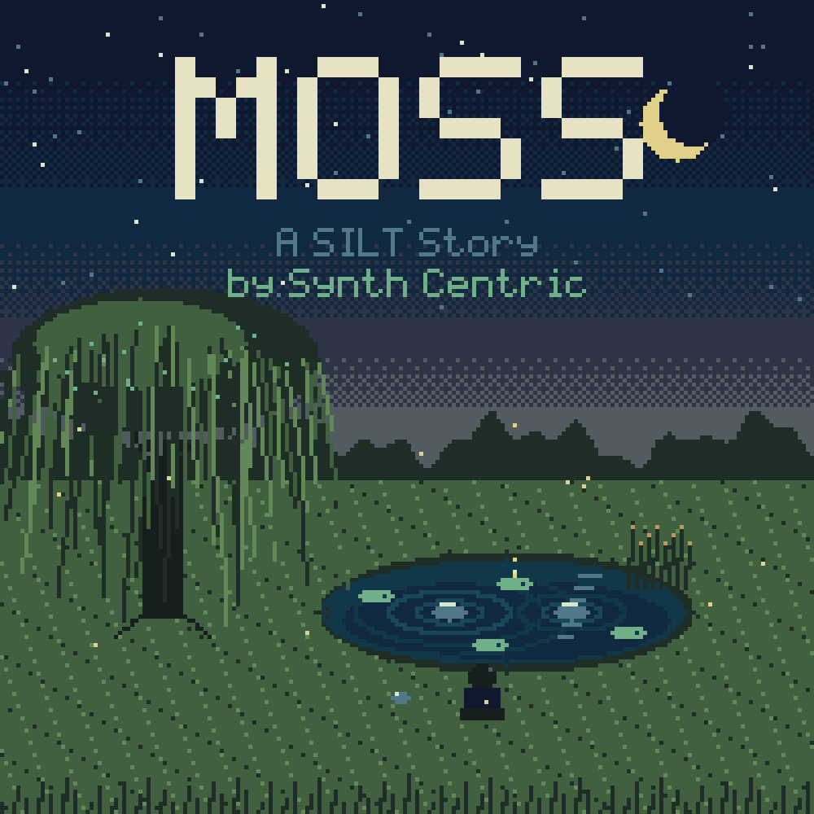

# MOSS

**A SILT Story** — an interactive musical adventure for the original Nintendo Game Boy.

**by Synth Centric**



A boy spends a last summer visit with his grandmother, Mae, in a quiet village.
Beyond the wood there is a small pond. When he drops a pebble into it, the
pond answers with a note — and something in the reeds answers back.

Over five days he learns eight ways of listening: wind, water, insects, hollow
wood, rain, echo, stillness and memory. Each one becomes part of the pond,
which is a real generative instrument running on the Game Boy's four sound
channels. At the end he leaves a stone by the water and walks away. The pond
keeps playing.

MOSS is a companion to the SILT trilogy (Nintendo DS, 3DS), not a numbered
sequel. It stands on its own.

## Play

The release is **`release/MOSS_by_Synth_Centric.gb`** — a standard 256 KiB
MBC5 + RAM + battery cartridge image for the monochrome DMG Game Boy. It does
not use, or need, Game Boy Color features.

- **Emulator:** open the `.gb` in SameBoy, BGB, Emulicious, mGBA, Gambatte or
  PyBoy. Saves go to the emulator's battery file (`.sav` / `.ram`); keep it
  next to the ROM.
- **Hardware:** copy the ROM to a flash cartridge that supports MBC5 with 8 KiB
  battery-backed SRAM (EverDrive-GB, EZ-Flash Jr., GB USB 64M and similar).
  Physical-hardware testing has **not** been performed for this release.

Controls: + pad walk · A talk/look · B cancel · START menu · SELECT notebook.
Stand still to listen. At the pond: A drops a pebble or places a lily, B
changes what you hold, SELECT just listens, START opens the pond's settings.
See [docs/CONTROLS.md](docs/CONTROLS.md) and the
[manual](release/manual/MOSS_Manual.md).

## What is here

| Path | Contents |
| --- | --- |
| `source/` | Game code (C, GBDK-2020): audio scheduler, composer, garden, memory, world, story, pond, UI |
| `assets/` | Editable sources: ASCII pixel art (tiles, sprites, pond screen, font), maps, artwork-source SVGs |
| `tools/` | Asset compiler, artwork, soundtrack capture, manual PDF, packaging, emulator drivers |
| `tests/` | Host tests (composer, saves) and emulator tests (full playthrough, systems) |
| `docs/` | Design and technical documentation, SILT continuity audit, testing |
| `release/` | The ROM, artwork, manual, liner notes, soundtrack, reports, checksums |
| `dist/` | Source ZIP and public distribution ZIP |

## Build

```sh
sh tools/bootstrap_toolchain.sh   # pinned GBDK-2020 4.3.0 into .toolchain/ (SHA-256 checked)
make                              # -> release/MOSS_by_Synth_Centric.gb
make test                         # host tests + ROM header check
```

Python 3 (standard library) generates the graphics and maps during the build.
See [BUILD.md](BUILD.md) for emulator tests, the soundtrack, artwork, manual
and release packaging.

## Documentation

[Game design](docs/GAME_DESIGN.md) ·
[World map](docs/WORLD_MAP.md) ·
[Audio engine](docs/AUDIO_ENGINE.md) ·
[Generative system](docs/GENERATIVE_SYSTEM.md) ·
[Musical memory](docs/MUSICAL_MEMORY.md) ·
[Saves](docs/SAVE_SYSTEM.md) ·
[Controls](docs/CONTROLS.md) ·
[Testing](docs/TESTING.md) ·
[Known limitations](docs/KNOWN_LIMITATIONS.md) ·
[SILT continuity audit](docs/SILT_CONTINUITY_AUDIT.md) ·
[Release notes](docs/RELEASE_NOTES.md) ·
[Credits](docs/CREDITS.md) ·
[Licences](docs/LICENSES.md)

Dan Schwebel, known as Synth Centric, is an Australian beat maker, music
producer, writer and educator.
