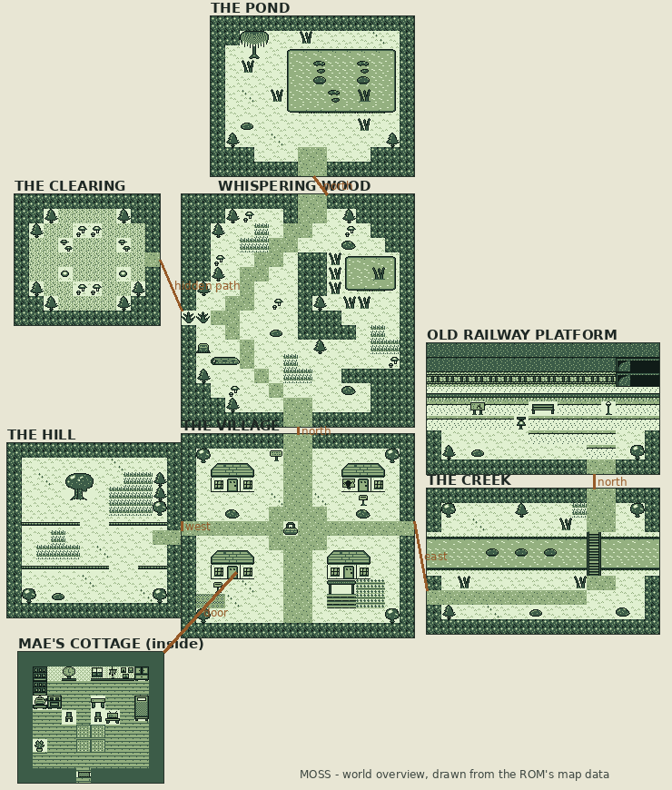

# World map

Each outdoor map is at most 16 × 16 metatiles (256 × 256 pixels), so a whole
map fits the Game Boy's background layer and scrolls without streaming. Maps
are written as text in `assets/maps/*.txt` (grid + legend + warps + objects +
listening zones + patches) and compiled by `tools/gen_assets.py`.

| Map | Size (16 px) | Tiles used / 144 | Music profile | What's there |
| --- | --- | --- | --- | --- |
| Mae's cottage | 10 × 9 | 79 | cottage: clock, low melody | kettle, clock, radio, books, photographs, cupboard, window, wind chime, bed, suitcase and boxes (day 4–5) |
| The village | 16 × 14 | 63 | village | Mae's cottage, Iris's grey-blue house, Ada's shop, Mr Hollis's house, garden and shelter, well, signpost, post boxes |
| Whispering Wood | 16 × 16 | 76 | wood: wind, knocks, birds | winding path, ferns, tall grass, mushrooms, the fallen log, the reed marsh, the fern wall (hidden path) |
| The pond | 14 × 11 | 81 | pond shore | the willow, the pond with two stones, lilies and reeds, the bank |
| The creek | 16 × 10 | 44 | creek: water | the bridge, the three stones, reeds |
| The old railway | 16 × 9 | 58 | railway: near-silence | platform, rails into the tunnel, the cutting, bench, lamp, station board, the bell |
| The hill | 12 × 12 | 39 | hill: open fifths | terraces, the meadow, the old oak at the top |
| The hidden clearing | 10 × 9 | 20 | clearing: almost silent | moss, mushroom rings, pale stones |
| Pond screen | 10 × 9 | 78 | the instrument | the 8 × 5 pond, stones A and B, banks, willow fringe |

## Connections

- Cottage door ↔ village (south-west house).
- Village north ↔ Whispering Wood (south) ↔ the pond (north of the wood).
- Wood west (behind the ferns, once found) ↔ hidden clearing.
- Village west ↔ the hill. Village east ↔ the creek ↔ (bridge north) the old railway.

## Small details

Animated water and tall grass tiles; rain over the whole day 3; lit windows in
the evening; the cat wandering on days 1–2, waiting by the ferns on day 3,
watching the pond on day 4; rings on the creek; fireflies in the clearing; the
reed creature at the pond; boxes appearing in the cottage on day 4; the stone
the boy leaves, which stays on the pond's bank after the ending.
