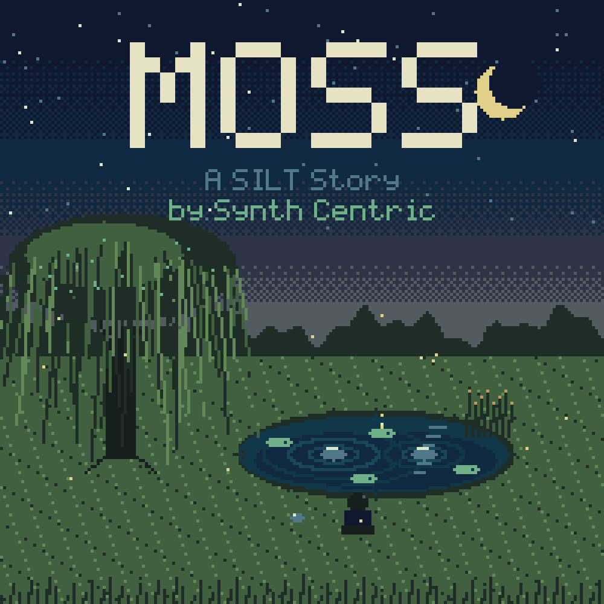

# MOSS — A SILT Story

**An interactive musical adventure for the original Game Boy, by Synth Centric.**

A boy spends a last summer visit with his grandmother. Past the wood there is
a small pond. When he drops a pebble in, it answers with a note — and over
five days he learns eight ways of listening that turn the pond into a living
instrument. Then he leaves a stone by the water, and goes. The pond keeps
playing.

## In this package

| File | What it is |
| --- | --- |
| `MOSS_by_Synth_Centric.gb` | the game: Game Boy ROM, 256 KiB, MBC5 + RAM + battery, DMG (no Color needed) |
| `manual/MOSS_Manual.pdf` (and `.md`) | the user booklet |
| `liner_notes/The_First_Listener.md` | notes on MOSS, childhood and the sound of a place |
| `liner_notes/The_Boys_Notebook.md` | the boy's field journal |
| `soundtrack/` | ten tracks recorded from the game (see its README for how) |
| `artwork/` | covers (3000 and 1000 px, text-free, back), SVG, banner, social, title screen, cartridge label mock-up |
| `testing/` | build and testing reports, known limitations |
| `MOSS_RELEASE_NOTES.md`, `MOSS_CREDITS.md`, `SHA256SUMS.txt` | |

## Playing

**Emulator:** open the `.gb` file in SameBoy, BGB, Emulicious, mGBA, Gambatte
or similar, using the original Game Boy (DMG) model. Saves live in the
emulator's battery file beside the ROM (`.sav`; PyBoy uses `.gb.ram`).

**Game Boy:** use a flash cartridge with MBC5 and 8 KiB battery save support.
*Physical hardware has not been tested for this release* — see
`testing/KNOWN_LIMITATIONS.md`.

**Controls:** + pad walk · A talk/look · B back · START menu · SELECT notebook.
Stand still to listen. At the pond: A pebble or lily · B change tool ·
SELECT just listen · START the pond's settings.

Use headphones: the Game Boy's sound is stereo through the headphone socket.

Dan Schwebel, known as Synth Centric, is an Australian beat maker, music
producer, writer and educator.
