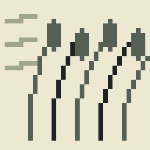
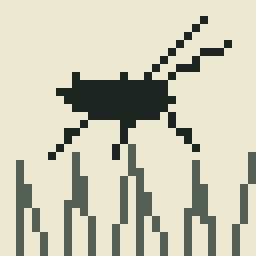
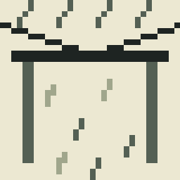
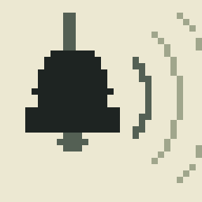
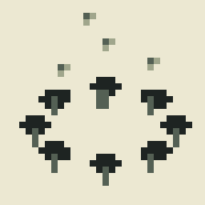

# THE SOUND NOTEBOOK

*A small notebook with a soft green cover. On the inside, in Mae's
handwriting: "Write down what you hear, not just what you see. Hearing's
harder to keep."*

*Everything below is from the game — the boy's own observations, in the order
a player might find them.*

---

## Day one. Arrival.

The car left me at the end of the lane. Mae's cottage was where it always
was. Smaller, I thought. Or I was bigger.

Mae says there's a pond past the wood. I didn't remember a pond. She says I
was four and threw my shoe in it.

There was a pond. Small. Quiet. Two flat stones sat in the water like they'd
been put there on purpose.

Plip. A ring opened on the water and a note came out of it. Not a splash. A
note.

Something in the reeds answered. When I looked properly there was nothing
there. Only reeds, and the ring still spreading.

---

## Day two. Listening.

### HOLLOW WOOD
*Whispering Wood, the fallen log*

Knock, and the log answers with a round sound, like a word I almost knew.

Iris says something lived in there. Maybe it still does. Maybe we just knocked
on its door.

### WIND
*Whispering Wood, the reeds*

The reeds sounded different when the wind moved through them. Not louder.
Different. Like the wind was choosing which ones to play.

### WATER
*The creek, three stones*

Upstream the water folds over a hidden stone and makes rings. A big ring. A
little ring. A middle-sized ring. Over and over.

Deep, high, in between. Exactly what the water was saying. Then the creek said
it back, lower and slower, as if it had been keeping the song for someone.

### INSECTS
*The hill, in the long grass*

At first, one cricket. Then I noticed it was answering another one. Then I
couldn't stop hearing them. The whole meadow, taking turns. Nobody talks over
anybody.

From the top of the hill the village looks like it was put down carefully, so
as not to wake anything. I could hear the creek, and the wood breathing, and
somebody's radio. All at once. None of them in charge.

---

## Day three. Rain.

### RAIN
*Mr Hollis's shelter*

The rain on the shelter roof had a rhythm. Not one rhythm. Several, taking
turns. Big drops from the tree. Small drops from the sky. A slow drip off the
corner, keeping time for all of them.

### ECHO
*The old railway, the bell*

Low, then high. Then, from the cutting, a moment later, it rang again.
Quieter. Then quieter still.

Two notes, low then high. I'd heard them somewhere before. I just couldn't
think where.

Mr Vale says he never noticed the train until it stopped coming. You hear a
thing best by its gap.

### STILLNESS
*The hidden clearing*

A faint sound from the west, like humming behind a closed door. The ferns
weren't a wall. They were a door.

At first I heard nothing.

Then I heard everything.

Lights were lifting out of the moss, slowly, as if they had been asleep and my
stillness woke them. I don't know what they were. I didn't move until they'd
gone.

---

## Day four. The last afternoon.

The cottage was full of boxes. The kitchen echoed in a way it hadn't
yesterday.

### MEMORY
*Mae's wind chime*

It rang. Two notes. Low, then high. The same two notes as the station bell.

Grandad hung it. When it rang he'd say the wind was coming from the railway,
even after the trains stopped.

Some sounds stay after the thing that made them has gone.

### The pond

Low, then high, like the bell.

The pond answered. Not with words. With the same two notes, turned round, and
then a few more of its own. Like it had been waiting to be asked properly.

---

## Day five. Early.

*— the last page —*

I'm leaving a stone by the pond. Not for the pond. The pond doesn't need
anything. It's so that something of mine gets to stay.

---

I thought I had found the pond.

But it was always here.
