# MOSS — A SILT Story

*An interactive musical adventure for the original Game Boy*

*by Synth Centric*

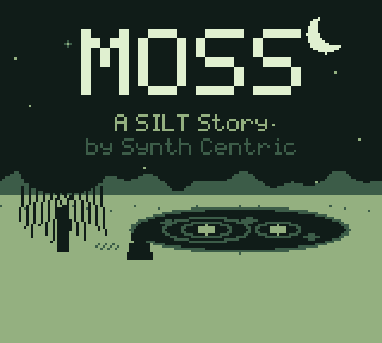

## 1. Welcome to MOSS

It is the end of summer. A boy has come to stay with his grandmother, Mae, in
a small village, probably for the last time: she is moving to a flat in town,
and the cottage is slowly turning into boxes.

Past the wood there is a little pond. He doesn't remember it. When he drops a
pebble into it, the pond answers with a note, and something in the reeds
answers back.

MOSS is a short adventure about learning to listen. There are no battles,
scores or levels. There are eight ways of hearing the world, a handful of
neighbours with their own lives, a notebook, and a pond that is a real
musical instrument. You can finish the story in an afternoon or two. The pond
stays open afterwards for as long as you like.

## 2. A SILT Story

MOSS belongs to the same small world as **SILT** (Nintendo DS), **SILT 2 — The
Living Pond** and **SILT III — The Last Visit** (Nintendo 3DS): generative
music releases in which a pond with two stones turns ripples into music. MOSS
is not a sequel. It may be the same pond, long before. You don't need to know
the other releases; if you do, you'll recognise the two stones, the eight by
five water, the circles and the old pentatonic notes.

## 3. Installation

**The file:** `MOSS_by_Synth_Centric.gb` — a 256 KiB Game Boy ROM with an
MBC5 memory controller and 8 KiB of battery-backed save RAM. It is made for the
original monochrome Game Boy and does not need a Game Boy Color.

**In an emulator** (SameBoy, BGB, Emulicious, mGBA, Gambatte, PyBoy…): open
the file. Choose the original Game Boy (DMG) model if asked. The emulator keeps
your save in a battery file beside the ROM (usually `.sav`; PyBoy uses
`.gb.ram`). Keep that file to keep your summer.

**On a Game Boy:** copy the ROM to a flash cartridge that supports MBC5 with
battery save RAM. Some flash carts copy the save to their memory card only when
you return to their menu or press reset — check your cart's instructions
before switching off. *This release has been tested in two emulators, not yet
on physical hardware.*

Use headphones if you can. The Game Boy's sound is stereo through the
headphone socket; the speaker is mono.

## 4. Getting Started

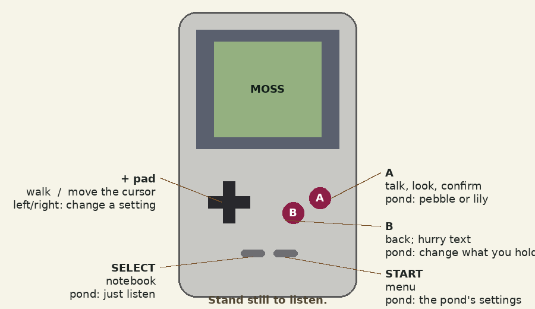

On the title screen choose **New summer** (or **Continue**, if you've saved).
A few lines of prose open the story; press A to turn the pages.

| Button | Walking | At the pond |
| --- | --- | --- |
| + pad | walk (tap to turn) | move the cursor |
| A | talk, look, confirm | drop a pebble / place or lift a lily |
| B | back; hold to hurry text | change what you hold |
| START | menu | the pond's settings |
| SELECT | the Sound Notebook | just listen |

Talk to everyone. Look at everything with A. And sometimes, don't press
anything at all (see *Listening*).

## 5. The Boy

He is about ten. He doesn't say much; he notices things and writes them
down. You'll read his thoughts in the first person: short sentences, the way a
child thinks when he's paying attention. He can walk anywhere he can see. He
can't fail. He will sleep when the day is done, and the bed will tell you
gently if there's still something waiting.

## 6. Mae's Cottage

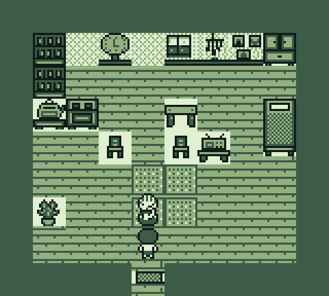

One room, the way small cottages are: kitchen, table, radio, shelves, a bed by
the window. The kettle sings before it boils. The clock is five minutes fast
and always has been. The radio plays a song Mae half-remembers. A wind chime
hangs in the window, quite still, because there's no wind indoors.

Mae will be here every day, cooking, packing, finding things. Each morning she
has something to say about the day ahead. On the fourth day the cottage is
full of boxes.

## 7. Exploring the Village

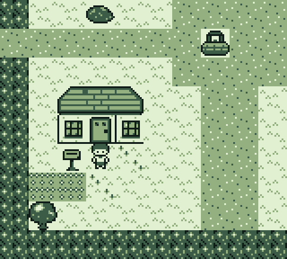

Four houses, a well, a signpost and a path in each direction.

- **North:** Whispering Wood, and beyond it the pond.
- **West:** the hill.
- **East:** the creek, and over the bridge, the old railway.

**Ada** keeps the shop and knows everyone's news. **Mr Hollis** grows beans
and knows the weather. **Iris** lives in the blue house (it's grey now, but it
used to be blue, so it still counts). **Mr Vale** used to be the stationmaster
and still goes up to the platform. There's also a cat. Nobody owns the cat.

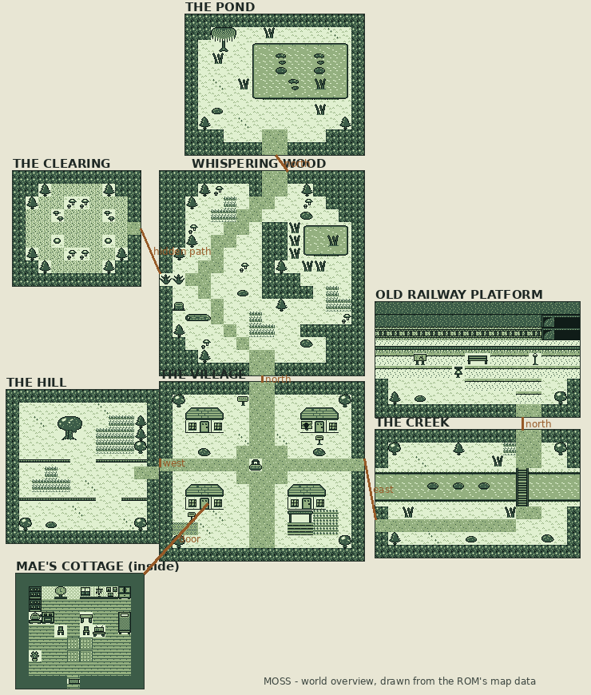

## 8. The Sound Notebook

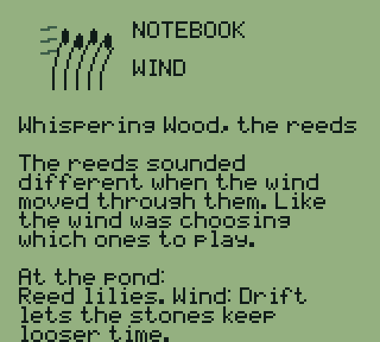

Mae gives the boy a notebook on the first evening. Press **SELECT** to open
it, and left and right to turn pages.

The first page says what day it is, where you might go next, and how many
ways of listening you've found. Each of the next eight pages fills in when you
discover something: a small drawing, where it happened, what he noticed, and
what it now does at the pond. They appear in the order *you* found them. After
the story ends, there is one more page.

## 9. Listening

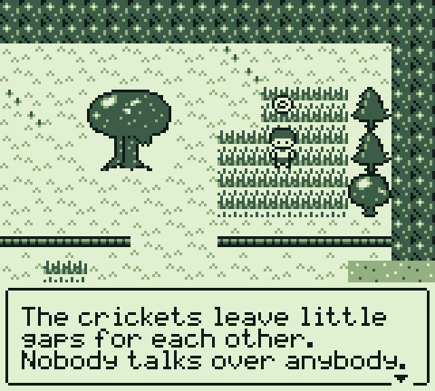

Stand still. After a moment (about a second and a half, or two and a half in
*Patient* mode — see Settings) a small ring appears above the boy and the
melody steps back so you can hear the place. In certain spots, if you wait a
little longer, something happens: a sound you hadn't noticed, a direction, a
small event.

You never have to wait long, and nothing that matters depends only on sound.
Every sound clue also appears as something you can see (rings, drifting notes,
lights) and as words.

## 10. Environmental Puzzles

There are six, and none can be failed.

- **The Three Stones.** At the creek, three stones in the water make three
  notes when you knock on them. Upstream, the water makes rings: big, little,
  middle. Listen, or watch the rings.
- **The Hidden Path.** Somewhere in the wood, the ferns are too neat.
  Listening there may tell you which way a sound is coming from. The cat may
  also have an opinion.
- **The Rain Shelter.** On the rainy day, stand under something with a wooden
  roof.
- **The Last Bell.** Ring the old station bell when it's raining, and wait.
- **The Still Clearing.** Stand in the middle and don't move.
- **The Pond's Answer.** On the last afternoon, try playing the pond the
  bell's two notes: low, then high.

If you're stuck, the notebook's first page always has a suggestion.

## 11. Discovering the Pond

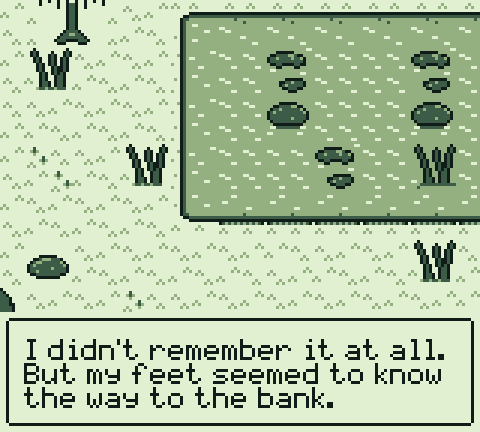

On the first day, follow the path north through the wood. Face the water and
press A: you'll be offered a pebble. After that, pressing A at the water's edge
asks whether you'd like to **sit and listen**. That opens the pond instrument.

## 12. Understanding the Musical Engine

The pond is not a recording or a playlist. Everything you hear is being decided
while you listen, by a small composer running on the Game Boy itself.

Two flat stones, **A** and **B**, send out ripples on their own slow cycles —
A every 48 sixteenth-notes, B every 64 (in Drift, 32 and 44). When a ripple
reaches a lily, the lily sounds. Higher rows play higher notes; lilies on the
left lean left in your headphones and lilies on the right lean right. Between
the ripples, the pond plays short phrases of its own, rests, remembers some of
them and plays them back changed. The water hums under everything and changes
its note every half-minute or so. Insects answer.

You change the **conditions**: which lilies are where, the scale, how busy the
pond is, the weather. The pond decides the notes. A little patience is as
useful here as a musical idea.

## 13. The Four Sound Channels

The Game Boy has four sound voices. MOSS gives each a part:

| Voice | Channel | In MOSS |
| --- | --- | --- |
| Pebbles | 1 — square wave with pitch sweep | your pebbles, bell lilies, the melody |
| Living sounds | 2 — square wave | insects, reed lilies, echoes |
| The water | 3 — a tiny programmable waveform | the low hum, root lilies, the harmony |
| The environment | 4 — noise | rain, wind, the creek, wooden knocks, the clock |

There's no reverb or sampling. When you hear an echo, it's a second note on
the other square wave, played quietly a moment later.

## 14. Playing the Pond

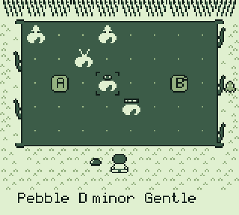

- **+ pad** moves the cursor around the eight by five water.
- **B** changes what you're holding: **Pebble**, then the lilies you've
  discovered — **Bell**, **Reed** (wind), **Root** (water), **Wood** (hollow
  wood).
- **A** with a pebble drops it: you hear its note at once, and a new ripple
  starts there. **A** with a lily places it; press A on the same kind of lily
  to lift it out, or on a different one to swap it. The stones stay where they
  are.
- **SELECT** hides everything except the water. Any button brings the cursor
  back.
- **START** opens the pond's settings:

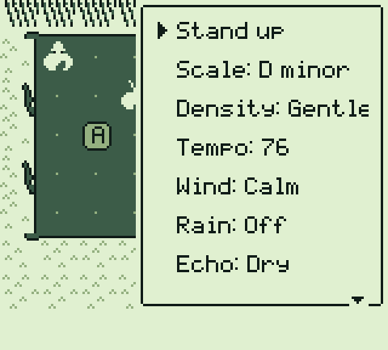

| Setting | Choices | Unlocked by |
| --- | --- | --- |
| Scale | D minor, C major, Open fifths, Suspended | — |
| Density | Still, Sparse, Gentle, Active | Still needs stillness |
| Tempo | 52–120 | — |
| Wind | Calm, Drift | wind |
| Rain | Off, Drizzle, Rain, Shower | rain |
| Echo | Dry, Mist, Deep | echo |
| Water | On, Off | water |
| Insects | On, Off | insects |
| Hold | Off, On (the harmony stops moving) | — |
| Clear lilies | empties the pond | — |
| Stand up | back to walking | — |

Use left and right on a setting to change it; the change is immediate.

## 15. Generative Composition

The pond's own playing follows a few rules:

- It plays in **phrases** of two to five notes, then **rests**. Rests get
  longer when the pond is Still or Sparse, and longer still in long, slow
  swells that rise and fall over several minutes.
- Each next note prefers small steps and notes that sound well with the water's
  current hum.
- It keeps a few recent phrases and sometimes plays one back, moved a little,
  with a note changed or the rhythm stretched — more often once you've found
  *memory*.
- Insects answer notes after a short pause, but they leave the high notes to
  the melody, the way animals in a real place share the air.
- Now and then everything but the water goes quiet for a while.

Nothing loops. You can listen for an hour and not hear the same half-minute
twice.

## 16. Musical Memory

The pond slowly learns how you play: which jumps between notes you like, how
quickly you play, which lilies you use, which scale and how busy you like it.
It leans a little toward those habits — never so far that it stops being
itself. Your pond's memory is kept with your save. To clear it, open
**Settings → Forget the pond**.

## 17. Saving

Open the menu with START and choose **Save** whenever you're walking. The game
also saves by itself after every discovery, at the start of each day, at the
end, and when you leave the post-game pond.

Your save is written twice, one copy after the other, with a check on each.
If a copy is ever damaged (a flat battery, a cart switched off mid-save), MOSS
uses the other one and tells you. Nothing you can do with the save will crash
the game.

## 18. Return to the Pond

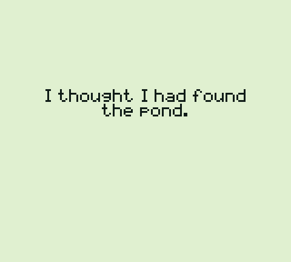

After the story ends, the title screen offers **Return to the pond**: the full
instrument, with every sound unlocked and eight starting points.

| Preset | Character |
| --- | --- |
| First Morning | a few bells and reeds; gentle; D minor |
| The Creek | warm water and low roots; C major; a little echo |
| In the Reeds | mostly reeds; sparse; drifting |
| Hollow Wood | wooden knocks; suspended; busy |
| Summer Rain | rain ripples; misty echo |
| Quiet Clearing | three lilies; still; deep echo; open fifths |
| Before Leaving | drizzle; drifting; C major; unhurried |
| The Pond Remains | the original SILT garden of twelve lilies |

Choose **Keep my pond** to store your own arrangement, and **Load my pond** to
come back to it. **Continue** takes you back to the last afternoon, by the
pond, if you'd like to walk around the village again.

### Things to try

1. **A very sparse pond.** Clear the lilies. Put three Bells anywhere. Density
   Still, Echo Deep, Open fifths. Leave it for ten minutes.
2. **A rain-driven piece.** Clear the lilies and scatter six or seven across
   the pond. Rain on Shower, Wind on Drift. The rain makes its own ripples;
   watch which lilies it finds.
3. **Let the insects answer the water.** Water and Insects on, two or three
   Root lilies low down, nothing high. Listen to what fills the space above.
4. **Interval studies.** With the Pebble, play the bottom row then the second
   row, again and again, for a few minutes; then leave the pond alone and hear
   what it has learned. Try the other jumps.
5. **Fifteen minutes.** Choose a preset, press SELECT, put the Game Boy down
   and listen without touching anything for fifteen minutes.
6. **Hold.** Find a moment you like and turn Hold on. The harmony stays; the
   pond keeps moving inside it.

## 19. Troubleshooting

| Problem | Try |
| --- | --- |
| No sound | Check the volume wheel / emulator volume. Settings → Volume. |
| Sound only in one ear | Settings → Sound: Mono. |
| My save disappeared | Keep the battery file next to the ROM; some emulators name it differently. On flash carts, return to the cart menu before switching off. |
| "The notebook's pages were smudged" | Both saved copies were damaged; start a new summer. |
| I'm stuck | Open the notebook (SELECT) — the first page suggests where to go. |
| Text is too slow / too fast | Settings → Text. Hold A or B to hurry. |
| Waiting to listen feels long | Settings → Listening: Quick. |
| The game asks for a Game Boy Color | It shouldn't; choose the DMG / original model in your emulator. |

## 20. Technical Information

| | |
| --- | --- |
| Format | Game Boy (DMG) ROM, 256 KiB |
| Cartridge | MBC5 + RAM + battery; 8 KiB SRAM (two 184-byte save copies) |
| Colour | none required (CGB flag 0) |
| Sound | four DMG channels, timer-driven scheduler at about 60 Hz |
| Built with | GBDK-2020 4.3.0 / SDCC 4.4.1, C |
| Tested with | PyBoy 2.9.0 and SameBoy 1.0.1 (DMG); full automated playthrough on both |
| Not tested | physical hardware |

The soundtrack included with this release was recorded from the game running
in an emulator; see the soundtrack's provenance file.

## 21. Credits

**MOSS — A SILT Story** by **Synth Centric**.

Dan Schwebel, known as Synth Centric, is an Australian beat maker, music
producer, writer and educator.

Development, writing, pixel art, music system, artwork and documentation were
produced with Claude (Anthropic) on Synth Centric's brief and the SILT trilogy.
The in-game alphabet is SILT's original 5 × 7 pixel font.

Thank you for listening.
