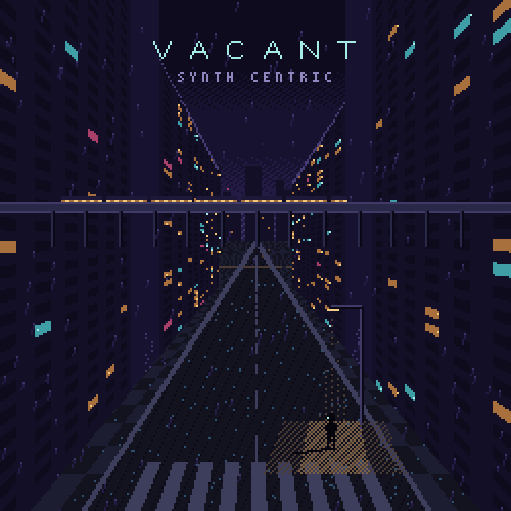

# VACANT

**An Endless City After Dark** — by **Synth Centric**

A Game Boy Color generative music experience: a procedurally generated city
you can walk forever, and an ambient soundtrack composed in real time by the
console's four sound channels. No story, no goals, no ending.



- **Play:** `release/VACANT_by_Synth_Centric.gbc` (MBC5 + RAM + battery, 128 KiB, Game Boy Color only)
- **Manual:** `docs/VACANT_Manual.md` (PDF in `release/`)
- **Release package:** `release/` — ROM, manual, artwork, preview, demo recording, docs, ZIPs

## Build

```bash
sh tools/bootstrap_toolchain.sh
```

```bash
make
```

```bash
make host-test
```

```bash
make test-emulator
```

Requirements, targets and tools: `docs/release/BUILD_INSTRUCTIONS.md`.

## Documentation

| Document | Content |
| --- | --- |
| `docs/VACANT_Manual.md` | the player's manual |
| `docs/ARCHITECTURE.md` | banks, memory, interrupt, streaming, RNG streams |
| `docs/WORLD_GENERATION.md` | the procedural city |
| `docs/AUDIO_ENGINE.md` | the four-channel generative composer |
| `docs/ASSET_PIPELINE.md` | editing and adding art |
| `docs/release/*.md` | release notes: controls, build, testing, limitations, credits |

## Layout

```
src/      C source (core, player, world, graphics, weather, audio, music, ui, save)
assets/   editable art (PNG + JSON) and palettes
tools/    asset generation, audio capture, validation, packaging
tests/    host tests (C) and emulator tests (PyBoy)
docs/     manual and technical documentation
artwork/  album cover (native 250 px painting and 3000 px master)
release/  distributable files
```

Licence: MIT (see `LICENSE` and `docs/release/CREDITS_AND_LICENSES.md`).
